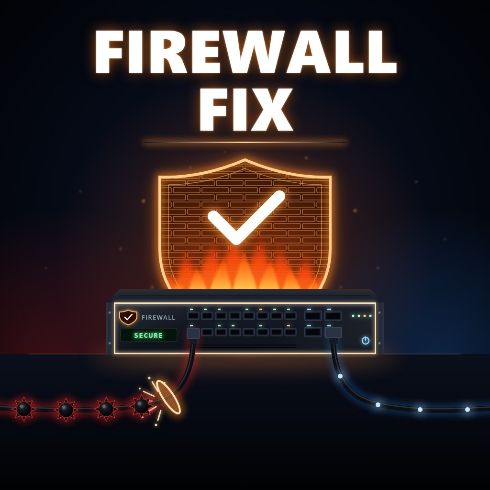

# Firewall Fix

A mod for **Data Center** (by Waseku) that fixes a bug where **malware gets straight past a correctly set-up firewall** and shuts your servers down.

**[Get it on the Steam Workshop](https://steamcommunity.com/sharedfiles/filedetails/?id=3831754850)** · [Download from GitHub Releases](https://github.com/checkersx/data-center-firewall-fix/releases)



**Contents:** [The bug](#the-bug) · [What it does](#what-it-does) · [A firewall that stops malware](#a-firewall-that-stops-malware) · [Before you install](#before-you-install) · [Install](#install) · [Settings](#settings) · [Still getting malware?](#still-getting-malware) · [Compatibility](#compatibility) · [How the bug works](#how-the-bug-works) · [Building from source](#building-from-source)

---

## The bug

You do the Internet Access ticket: a router with the customer's subnet, a firewall with an allow rule, everything cabled up. The ticket completes. But every 10 minutes, black malware packets still come in from the Internet, travel along your cables, and switch your servers off, as if the firewall weren't there.

It isn't your setup. The game gives every switch, router and firewall an ID, and each cable remembers the ID of the device at each end. Sometimes, after you load a save or place a new device, a device's cables keep an *old* ID. The malware looks for firewalls by their ID, can't find yours, and treats it as a plain piece of cable. Because of the same mix-up, the firewall's rules don't apply to normal traffic either.

## What it does

- **Fixes the IDs.** Every 30 seconds, and right before each malware attack, it finds cables that name a device by an outdated ID and corrects them. Your firewall then stops malware the way it should, and its rules apply.
- **Fixes customers losing all connectivity after a load.** If a newly bought switch ends up with the same ID as one you already have, the game mixes the two up when you next load, and the customer behind your working switch goes offline. The mod gives the new switch its own ID, and repairs saves where that has already happened.
- **Fixes servers that won't connect although they're plugged into a working switch.** Sometimes the game records a switch's cables as belonging to a different switch, so it can't see the link, and the servers behind it stay offline (and their ticket never completes). The mod puts each cable back on the switch it's actually plugged into.
- **Tells you what each attack hit.** The MelonLoader console shows a line per attack, such as `Malware attack: no servers exposed; 1 firewall blocking.`, or which servers the malware could reach.
- **Optional: no malware at all.** One setting switches malware attacks off (see [Settings](#settings)).
- **Works on your existing saves.** Nothing extra is saved, so you can remove the mod at any time.

## A firewall that stops malware

Malware starts at the Internet and follows every cable. A firewall stops it when:

- the firewall is **switched on**,
- every cable route from the Internet to your servers **goes through it** (Internet → router → firewall → your switches, or Internet → firewall → router → …: both work),
- it has **no "allow everything" rule** (allow, any port, no source, no destination). Any other rules block malware.

For the Internet Access ticket, one rule is enough: **allow port 443 from the customer's subnet** (for example `192.168.1.0/24`).

**Do I need a "deny any any" rule?** No. A firewall already blocks anything that no rule allows. Keeping one does no harm, as long as it's below your allow rules (the first rule that matches wins).

---

## Before you install

You need these once, for any code mod in Data Center. If you already use other code mods, you most likely have them.

1. **MelonLoader 0.7.3** from the [MelonLoader releases page](https://github.com/LavaGang/MelonLoader/releases). Run the installer, point it at `Data Center.exe`, choose **0.7.3** and install. Start the game once, then quit.
2. **A fix-up plugin**, or no code mods load at all: [DS-InteropFix](https://steamcommunity.com/sharedfiles/filedetails/?id=3797166996) (Steam Workshop) or [Il2CppAssemblyFixer](https://github.com/mleem97/Il2CppAssemblyFixer) (GitHub). Follow its own instructions.

## Install

There's one file: **`FirewallFix.dll`**. It goes in the **`Mods`** folder inside your game folder. To open the game folder: in your Steam Library, right-click **Data Center** → **Manage** → **Browse local files**. Use the `Mods` folder next to `Data Center.exe`, not the one inside `StreamingAssets`.

- **From GitHub:** download `FirewallFix.dll` from the [Releases page](https://github.com/checkersx/data-center-firewall-fix/releases), put it in `Mods`, and start the game.
- **From the Steam Workshop:** subscribe on the [Workshop page](https://steamcommunity.com/sharedfiles/filedetails/?id=3831754850). If you have WorkshopModSync (see below), that's all: start the game. Without it, start the game once and quit, then open `Data Center_Data` → `StreamingAssets` → `Mods` in your game folder, type `FirewallFix.dll` into File Explorer's search box, and copy the file it finds into your game's `Mods` folder.

**Check it worked:** the MelonLoader console shows `Firewall Fix v1.2.0`, and within 10 minutes of play it shows a line starting `Malware attack:`.

**WorkshopModSync** is a free helper by Bloody that copies your subscribed Workshop code mods into the right folders every time the game starts. It comes with Bloody's [DHCP Mod](https://steamcommunity.com/sharedfiles/filedetails/?id=3773467133). You have it if your game folder's `Plugins` folder contains `WorkshopModSync.dll`.

**Updating:** with the game closed, replace `FirewallFix.dll` with the new one (WorkshopModSync does this for you).
**Uninstalling:** with the game closed, unsubscribe on the Workshop first (so WorkshopModSync doesn't put it back), then delete `FirewallFix.dll` from `Mods`.

## Settings

In `UserData\MelonPreferences.cfg` in your game folder (it appears after the first run with the mod), under `[FirewallFix]`. Edit it with the game closed.

| Setting | Default | What it does |
|---|---|---|
| `RepairCableIds` | `true` | The firewall fix itself, and the fix for cables recorded on the wrong switch. Leave it on. |
| `RepairDuplicateIds` | `true` | Gives switches that share an ID their own, so customers stay connected after a reload. Leave it on. |
| `DisableMalware` | `false` | Set to `true` to switch malware attacks off completely. |

## Still getting malware?

Look in the MelonLoader console (or `MelonLoader\Latest.log`) for `Malware attack: N server(s) exposed (…)`. It names the servers malware could reach. Each of them has a cable route from the Internet that doesn't go through a working firewall: a second cable to the Internet that skips the firewall, a firewall that's switched off, or one with an "allow everything" rule.

Otherwise, open an issue on [GitHub](https://github.com/checkersx/data-center-firewall-fix/issues) and include `Data Center\MelonLoader\Latest.log`.

## Compatibility

- Standalone: no gregCore or other framework needed. Works alongside other mods, including [Next-Gen Hardware](https://github.com/checkersx/data-centre-next-gen-hardware).
- **Co-op has never been tested.** Malware attacks are run by the host, so the host needs the mod. To be safe, install it for every player.
- Tested on Steam build 25869593 of Data Center, with MelonLoader 0.7.3.
- Not affiliated with Waseku.

---

## How the bug works

For anyone curious, or for fixing it in the game itself.

- `MaliciousAttackManager.ComputeAttacks` builds a graph from every cable in `WaypointInitializationSystem.GetAllCables()`. A switch end becomes a node named after `CableEndpoint.SwitchID`.
- It treats firewalls as walls: every firewall from `NetworkMap.GetAllFirewalls()` that is on and has no blank allow-all rule, keyed by `NetworkSwitch.switchId`.
- It runs a BFS from `"Internet"` that doesn't expand walls, and attacks every powered server it reaches.
- When a device's `switchId` and its cables' `SwitchID` differ, the firewall's node is never recognised as a wall, so malware passes through it. Route evaluation looks devices up by the cable's ID too (`GetSwitchById` returns null), so the firewall's rules are skipped as well.
- The mismatch was seen in a real save: firewall `Firewall4xQSXP16xSFP_3088501392`, its cables `Firewall4xQSXP16xSFP_-111464`. The cable side changes every session; the device side persists.
- It also shows up after placing a new switch: its ports (`CableLink.switchID`) and cables carry an ID the device no longer has.
- The game already has the right repair, `NetworkSwitch.PatchStaleSwitchId` (stale ID with the same name prefix → current ID), but only calls it from `ReconnectCables`, when a device powers on.

The mod does the same for every switch, router and firewall: for each port, it corrects a stale `CableLink.switchID`, finds the port's cable end (≤ 0.3 m from the port), corrects a stale `SwitchID` through `UpdateCableInfo`, and then calls `NetworkMap.RemapDeviceId(old, new)` for routing. An ID counts as stale when it isn't the device's own ID, names no device that exists, and has the same name prefix. The repair runs every 30 seconds and in a Harmony prefix on `ComputeAttacks`.

### Duplicate device IDs

- When a save is loaded, `NetworkSwitch.SwitchInsertedInRack(SwitchSaveData)` checks `ContainsDuplicateSwitchId`. If the ID is taken, it gives the device a new one and calls `NetworkMap.RemapDeviceId(old, new)`. But that moves the map entry of the device that *already had* the ID, and `RegisterSwitch` only adds a key that's absent. So the renamed device is never registered, and `NetworkMap.switches[newId]` is the other device.
- Path finding (`FindAllServerPathsFromCustomerPure`, `FindAllShortestPaths`) skips any node whose entry in `switches` is switched off. If the other device is a boxed, unpowered switch, every route through the renamed one is cut.
- Duplicates can appear when a mod gives new devices an ID of its own, for example one made from where they spawn: the shop always delivers to the same spots, so a new switch can take the ID of an older one of the same model.
- The mod gives every copy but one (the one registered in `NetworkMap`) a fresh `GenerateUniqueSwitchId()`, together with its ports, as long as it has no cables. Then, for any device whose ID is filed under a different device in `NetworkMap.switches`, it puts the device back and re-registers the other one under its own ID. This runs every 30 seconds, before each attack, and in a prefix on `SaveSystem.SaveGame`. A last-priority postfix on `SwitchInsertedInRack` also catches a device placed with another device's ID (for example when a mod puts back the ID it had before placement) and returns it to the ID the game just gave it, which its ports and `NetworkMap` already use.

### Cables recorded on the wrong switch

- When a save loads, the game repairs stale cable IDs ("Restoring SwitchID logic", `[Load] Remapping stale switch ID`). For each port with a cable, it takes whichever of the cable's endpoint IDs has the port's name prefix and names no existing switch, and calls `NetworkMap.RemapDeviceId(stale, portId)` for the whole map. It never checks which end is in the port, so a stale ID can be handed to a different switch of the same model.
- Once a cable names a switch that exists, nothing treats it as stale again. The switch it's really plugged into then looks unconnected: in one save, every cable in three switches was recorded on three others, and new servers on those switches couldn't connect.
- Each port records the cable plugged into it (`CableLink.cableIDsOnLink`). When a port holds a cable whose nearest end (≤ 0.3 m) names another switch of the same model, and that switch has no port holding that end at least as close, the mod renames the end to the port's switch. The map is fixed one cable at a time, like the game's own power-off and power-on (`RemoveCableConnection(id, preserveLACP: true)`, `UpdateCableInfo`, `RegisterCableInNetworkMap`). LACP groups follow, and routes are re-evaluated. This is part of the 30-second repair.

## Building from source

You need the .NET SDK (6 or later) and the game with MelonLoader installed (start the game once so MelonLoader generates its files).

```
dotnet build -c Release src
```

The build looks for the game at `G:\SteamLibrary\steamapps\common\Data Center`. If yours is somewhere else, add `-p:GameDir="<your game folder>"`. The built DLL is copied straight into the game's `Mods` folder (add `-p:Deploy=false` to skip that). Close the game first, because the game locks the DLL while it's running.

`workshop\build-package.ps1` builds the Steam Workshop upload into `publish\`.

## Licence

[GNU General Public License v3.0](LICENSE).
